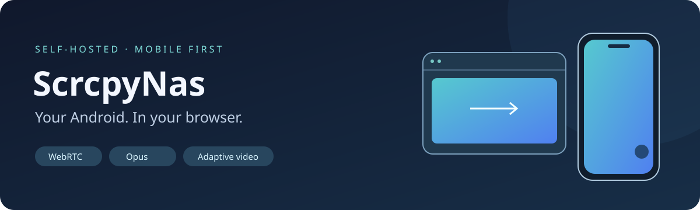
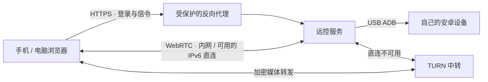

<p align="center"></p>

<h1 align="center">ScrcpyNas · Mobile Remote</h1>
<p align="center">把自己的安卓设备，带进手机和电脑的浏览器。</p>
<p align="center"><a href="#体验与能力">功能</a> · <a href="#连接方式">架构</a> · <a href="#使用前请先读">开始之前</a> · <a href="THIRD_PARTY_NOTICES.md">第三方许可</a> · <a href="SECURITY.md">安全边界</a></p>

> **发布状态：源码公开准备版。** 基于已回退并由使用者确认恢复正常的代码快照整理。尚未提供可直接安装的发行包。来源或再分发通知未核验完整的引擎产物、ADB、视频 JAR 和平台图片不随本目录分发，因此当前目录不能直接完成投屏或构建安装包。完整清单见 [发布准备说明](docs/PUBLICATION.md)。

这是基于 [zgcwkjOpenProject/ScrcpyNas](https://github.com/zgcwkjOpenProject/ScrcpyNas) 的衍生改进，保留原项目的 NAS 套件结构和安卓控制基础，重点完善移动端操作、WebRTC 传输、声音连续性与故障恢复。原作者和第三方贡献者的版权、许可证均应继续保留。

## 体验与能力

| 日常使用 | 传输与播放 | 长期运行 |
| --- | --- | --- |
| 设备卡片首页，点击即进入 | WebRTC 视频与独立控制通道 | USB ADB 接入，减少无线调试抖动 |
| 单击悬浮菜单，双击沉浸全屏 | 原生 WebRTC Opus 音频及兼容回退 | 视频温会话与音频进程隔离 |
| 两行三列快捷操作 | 内网直连、可用时 IPv6 外网直连 | 前后台切换后的音画恢复 |
| 常用／画质／详情分区 | TURN 中转兜底，自动适应画质 | 持久登录与修改密码 |
| 声音开关即时生效并保存 | 减少静止内容重复编码 | 可到期、可撤销的只读分享链接 |

**清晰度随连接能力调整。** 内网与健康直连可逐步使用最高 1920 px、6 Mbps、60 fps 的目标；带宽受限的中转采用更保守的档位。目标帧率是上限，实际帧率取决于画面变化、编码、网络和接收端。

**声音以连续播放为先。** 使用 Opus 48 kHz、目标 96 kbps，按采样数推进媒体时钟；网页默认原声增益，保留用户音量调节。浏览器自动播放权限、通话、耳机和系统音频路由仍可能影响输出。

**登录可以记住。** 使用安全 Cookie 和服务端持久会话，连续 30 天未使用才失效；退出或改密码会撤销旧凭证。浏览器清除网站数据后需要重新登录。

## 连接方式



WebRTC 直连能减少绕路和中转带宽限制，但不保证每个蜂窝网络都能建立。TLS/WSS 兼容通道的加密终点与 WebRTC 不同；控制服务器、信令和页面托管方都属于信任范围，不能据此声称所有路径都对服务器端到端保密。

## 使用前请先读

这个目录目前用于**源码阅读、改进记录和发布准备**，不是无人值守的一键公网部署包。

1. 阅读 [发布准备说明](docs/PUBLICATION.md)，补齐精确版本的运行引擎、视频服务和完整第三方通知。
2. 使用与目标硬件匹配、来源可信的 ADB；安卓开启 USB 调试并在设备上授权。
3. 安装 Node.js 运行依赖。原平台适配使用 fnOS Node.js 24 或 DSM Node.js 22；其他环境需要自行验证。
4. 为私有部署单独生成登录签名密钥、密码摘要和 TURN 配置。运行数据存放在仓库外，不能提交实际配置。
5. 使用 HTTPS 和经过鉴权的反向代理。**不能把 Node 服务或 ADB 直接暴露公网**；会话检查接口不是所有 HTTP/WebSocket 路由自动受保护的替代品。

可先恢复已有锁定的 JavaScript 依赖，以下命令**不会补齐被隔离的运行产物，也不会启动远控**：

```sh
npm ci --ignore-scripts --prefix common/engine
npm ci --ignore-scripts --prefix common/server/rtc
node common/server/rtc/apply-werift-fixes.cjs
```

私有登录还需要 `express-session@1.19.0` 与 `session-file-store@1.5.0`；浏览器集成测试需要 Playwright、浏览器运行时及合成媒体测试用的 FFmpeg。这些依赖的安装目录和 `NODE_PATH` 需要显式配置。完整安装配方和干净环境验证仍是发布待办，不把私有主机上的既有依赖当作仓库自带能力。

## 目录导航

```text
common/server/          服务编排、登录、分享、音视频与移动端界面
common/server/rtc/      WebRTC 固定依赖及明确版本的补丁
common/server/test/     单元测试和合成音视频浏览器测试
common/engine/         引擎许可、依赖锁与来源说明（运行产物待补齐）
common/tools/          ADB 获取与许可说明（不随附未核验二进制）
platforms/             fnOS / DSM 套件适配与构建脚本
scripts/               公开文件检查
LICENSE                原项目 Apache-2.0 许可证
NOTICE                 原项目归属及本分支修改说明
THIRD_PARTY_NOTICES.md  第三方许可和发布范围
```

原平台构建入口为 PowerShell 7 的 `build.ps1`，产物约定在 `dist/`。在运行依赖、图标和许可文件补齐前，不应把构建结果当作正式发行版。

## 已验证与边界

- 参考部署已验证 iPhone 浏览器远控安卓、USB 接入、内网高清、外网 IPv6 直连、TURN 兜底和音频恢复；这不等于所有手机、浏览器与运营商组合都已通过。
- 自动画质、首帧请求、页面资源压缩和加载反馈已有实现；不承诺每次一秒首屏或原生游戏延迟。
- 悬浮圆点显示的是**网络往返 RTT**，不是从安卓采集到浏览器显示的完整延迟。
- 浏览器可能冻结后台页面；服务端保温不能保证操作系统永远允许后台播放。
- 最近尝试的增量 ICE、拥塞控制事件合并和新增诊断组合曾导致实机连接失败，已整体撤回，**不计入当前版本能力**。
- Android 系统、应用的音频捕获政策及受保护内容限制仍适用；不提供绕过 DRM 的功能。

## 开发与贡献

阅读 [AGENTS.md](AGENTS.md)，保持功能改动小而可回退。测试请使用合成图像与声音，不提交真实录屏、设备序列号、浏览器 Cookie 或连接日志。已有的测试说明可在 [测试目录](common/server/test/README.md) 中查看；依赖未补齐时，完整媒体集成测试不可运行。

发布前运行：

```sh
python3 scripts/check-publication.py
```

检查工具只做固定规则的敏感文件和高置信凭据检查，不能替代完整安全审计或版权审查。错误报告请提供脱敏后的浏览器版本、连接类型、复现步骤和时间，避免上传完整配置。

## 许可证与致谢

主项目沿用 [Apache-2.0](LICENSE)，保留原作者 **zgcwkj** 的声明。本分支不是上游官方发行版，也不代表 fnOS、Synology、Android 或其他相关项目的官方支持。

感谢 [ScrcpyNas](https://github.com/zgcwkjOpenProject/ScrcpyNas)、[ws-scrcpy / Netris](https://github.com/NetrisTV/ws-scrcpy)、[scrcpy / Genymobile](https://github.com/Genymobile/scrcpy)、[werift](https://github.com/shinyoshiaki/werift-webrtc) 和 [wasm-audio-decoders](https://github.com/eshaz/wasm-audio-decoders) 及其依赖的贡献者。

第三方内容遵循各自许可证，不因放入本仓库而统一改为 Apache-2.0。详见 [THIRD_PARTY_NOTICES.md](THIRD_PARTY_NOTICES.md)。
